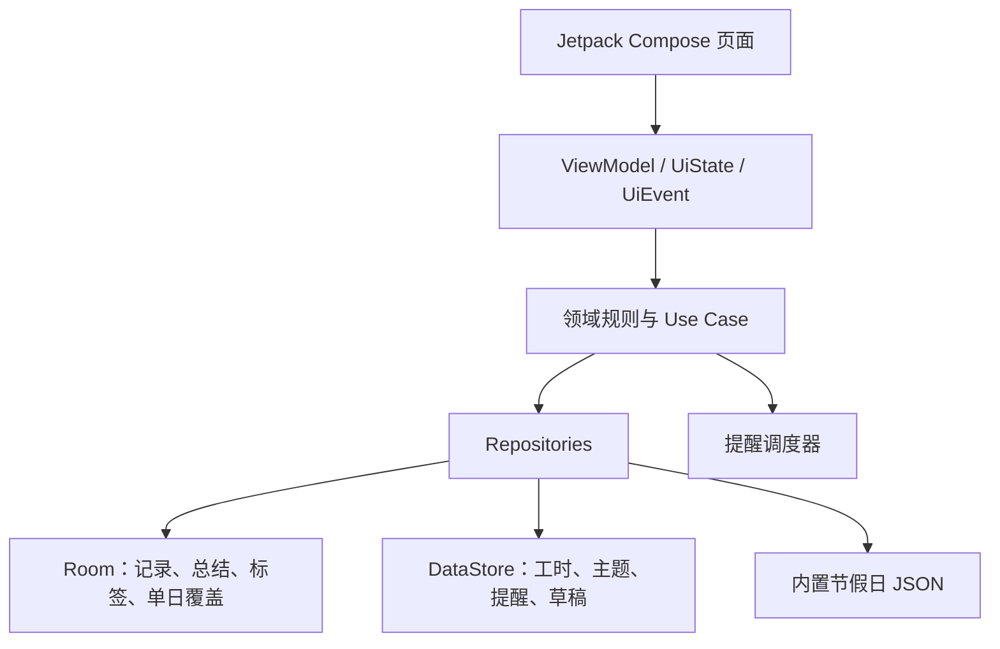

# 牛马日记：开源调研、产品设计与技术架构方案

> 方案日期：2026-08-07
> 当前状态：调研与架构已完成，尚未创建 Android 工程、尚未编写业务代码。

## 1. 结论先行

“牛马日记”应做成一个 **原生 Android、离线优先、打开即记录** 的个人应用。

- 平台：Kotlin + Jetpack Compose，只优先服务 Android，重点真机为 OPPO Find X8 Ultra。
- 首页：启动后直接进入“今天”，不强制经过登录、引导或仪表盘。
- 核心路径：点选精神状态 → 输入一句吐槽 → 保存；整个过程不超过两步。
- 数据：Room 本地数据库是唯一事实来源，不需要账号、后端、广告或埋点。
- 架构：单 Activity、Compose、ViewModel + 单向数据流、Repository、Room/DataStore；先保持单 Gradle 模块，避免小项目过度拆分。
- 作息默认：09:00–18:00，**固定双休，周末永不上班**；法定节假日休息。设置里另提供“跟随国务院调休补班”模式。
- 视觉：晚霞照片作为全局视觉母题，首页全屏使用；其他页面使用同图的弱化版本。哈吉米图片制作成 Android adaptive icon。
- 隐私：MVP 不申请联网权限；提供 JSON 完整备份和 Markdown 人类可读导出，可选生物识别锁。

选择原生 Android 的原因很直接：目标设备只有一台高端 Android 手机，核心需求又涉及 edge-to-edge、键盘避让、桌面快捷入口、本地通知、生物识别与 ColorOS 真机行为。Flutter/React Native 能做，但会增加一层运行时和平台适配成本，却没有换来当前需要的跨平台收益。

## 2. GitHub 相似项目对比

以下仓库只用于产品与架构研究。多数采用 GPL/AGPL 强 copyleft 许可，因此本项目不复制其业务代码或素材，只借鉴经过抽象后的产品思路，并优先采用 MIT/Apache-2.0 的基础库。

| 项目 | 技术栈与功能 | 优点 | 局限与本项目取舍 |
| --- | --- | --- | --- |
| [Daily You](https://github.com/Demizo/Daily_You) | Flutter；日记、心情、照片、Markdown、提醒、离线存储与迁移；GPL-3.0 | 产品边界清晰，强调无账号、无广告、数据归用户；已有成熟发布与社区 | Android-only 项目没有必要承担 Flutter 跨平台层；借鉴离线优先、温和提醒和可迁移数据，不复用代码 |
| [SoulSync](https://github.com/Antimatter543/mood-tracker) | React Native + Expo、TypeScript、SQLite、Reanimated、图表与日历；GPL-3.0 | 与需求最接近：一天多次带时间记录、活动标签、热力日历、趋势/星期分布；数据库和统计转换有大量测试 | 项目较新，React Native/Expo 对单一 Android 目标收益有限；借鉴数据模型、统计口径和测试策略 |
| [Mood Cairns](https://github.com/lcdcode/mood-cairns) | Kotlin、Compose、Room、Hilt、DataStore、WorkManager、Vico、SQLCipher；单模块 MVVM；GPL-3.0 | 最接近目标技术路线：完全离线、多维状态、标签、提醒、趋势、加密备份、生物锁和小组件；测试质量较好 | UI 偏工具化且没有完整月历主页面；作为隐私、状态模型和质量标杆，不复制 GPL 实现 |
| [MyBrain](https://github.com/mhss1/MyBrain) | 100% Kotlin、Jetpack Compose、多模块、Clean Architecture、MVI、Room、Koin、DataStore、AlarmManager、生物识别；GPL-3.0 | 最有价值的原生架构参考；日记、心情图表、月历、提醒和小组件均有实践 | “任务+笔记+日历+AI+书签”范围太大，多模块对本项目首版过重；借鉴分层和单向数据流，不做全能效率工具 |
| [Flux](https://github.com/chindaronit/Flux) | Kotlin、Compose、Room、Hilt、DataStore、WorkManager；时间线、标签、搜索、热力图和趣味统计；GPL-3.0 | 毫秒时间戳天然支持一天多条日志；“最难熬星期几”、热力图与时间线很有参考价值 | 功能蔓延明显，部分 ViewModel/统计职责过重且测试不足；只借鉴数据表达和产品文案 |
| [My Diary](https://github.com/sinan-q/My_Diary) | Kotlin、Compose Material 3、Room、Hilt、DataStore；轻量单模块 MVVM；MIT | 月历分页、日期点击和日记跳转清晰，体量小、许可宽松 | 实体只存 `LocalDate`，无法满足一天多条精确时间记录；无情绪统计和有效测试，不能直接作为成品底座 |
| [moodiary](https://github.com/ZhuJHua/moodiary) | Flutter + Isar + GetX + Rust；富文本/Markdown、多媒体、搜索、WebDAV、局域网同步、生物识别、本地 NLP；AGPL-3.0 | 中文生态成熟，展示了完整日记产品在导入导出、搜索、安全和多媒体上的上限 | 依赖面和工具链非常大，包含 Rust、实验性 Isar 与大量平台插件；本项目暂不做 AI、多媒体和云同步 |
| [Easy Diary](https://github.com/hanjoongcho/aaf-easydiary) | Kotlin/Android，Realm，传统 View/DataBinding 与 Compose 混合；日历、时间线、图表、语音、主题、锁、Drive 备份；GPL-3.0 | 长期维护、功能验证充分；时间线、日历跳转、锁与备份值得参考 | 历史包袱较重，混合 UI 和较多旧依赖不适合新工程；只借鉴成熟交互，不沿用技术结构 |

### 2.1 明确借鉴的部分

- SoulSync：一天可多次记录、每条记录独立时间戳、标签与统计转换测试。
- Mood Cairns：完全离线、隐私锁、状态量表、提醒和数据库/备份测试。
- Daily You：本地优先、无账号、草稿与迁移意识。
- MyBrain：Compose + Room + ViewModel/Flow 的原生分层方法。
- Flux：时间戳时间线、热力图和轻松有趣的统计表达。
- My Diary：轻量月历交互；数据实体必须重新设计为支持一天多条记录。
- Easy Diary：时间线、日期跳转、备份/恢复和隐私锁。
- moodiary：导出格式版本化，以及日记数据不默认送往云端 AI 的原则。

### 2.2 明确不做的部分

- 不做任务管理、书签、社交社区、好友排名。
- 不做云端 AI 情绪分析，也不输出“抑郁指数”等医疗化判断。
- 首版不做图片/音频/视频附件、WebDAV、账号同步。
- 不做断签惩罚或焦虑式连续打卡。
- 不从 GPL/AGPL 项目复制实现，避免许可证与产品所有权混乱。

## 3. 产品定位

一句话定义：**给刚开始上班的人，一个不打扰、随时能吐槽、还能回看精神状态变化的私人小本子。**

核心原则：

1. 打开就是今天，今天页面就是输入页面。
2. 没有内容也可以只记精神状态；没有状态也可以只写一句话。
3. 保存必须快，断网必须可用，退出后草稿不能丢。
4. 统计提供趣味观察，不给用户下结论，不把缺失数据当坏状态。
5. 视觉有个性，但正文始终比背景和动画更清楚。

## 4. 页面与信息架构

```text
牛马日记
├─ 今天（启动页）
│  ├─ 工作/下班倒计时
│  ├─ 一键精神电量
│  ├─ 随手吐槽输入框
│  ├─ 今日记录时间线
│  └─ 今日收工总结
├─ 日历
│  └─ 某日详情（完整时间线 + 当日总结）
├─ 统计
│  ├─ 工位生存概览
│  ├─ 精神状态趋势/分布
│  ├─ 时段与星期观察
│  └─ 趣味结论卡
└─ 设置
   ├─ 入职日与工时
   ├─ 固定双休/官方调休
   ├─ 提醒
   ├─ 隐私锁
   └─ 导入/导出
```

底部使用四个入口：**今天、日历、统计、设置**。首次使用不显示强制引导；“设置入职日期让统计更准”以首页小卡片提示，不阻塞记录。

### 4.1 今天页

从上到下：

1. 日期与一句轻量问候。
2. 倒计时卡：上班前显示“距离开机”，工作中显示“距离下班”，休息时显示“距离下次上班”。
3. 五档精神电量：`裂开 / 麻了 / 凑合 / 还行 / 满血`，可单独一键保存。
4. 始终可见的输入框：“此刻想吐槽点什么……”，支持可选标签：`开会 / 改需求 / 通勤 / 午饭 / 摸鱼 / 被夸 / 加班 / 下班啦`。
5. 今日时间线，每条显示 `HH:mm`、精神状态、标签与正文；编辑后保留原始记录时间，并标注“已编辑”。
6. 18:00 后提高“今日收工报告”的视觉优先级，但全天都能手动总结。

保存成功后只做一次轻触觉反馈和短文案，例如“已存档，工位没有听见”。不使用持续动画或强制分享。

### 4.2 日历页

- 月视图中，每个日期显示代表状态、记录数量和工作/休息属性。
- 当日代表状态优先取“收工总结的整体状态”；没有总结时取最后一次精神状态记录。
- 只有文字、没有状态时显示中性记录点，不擅自推断情绪。
- 点击日期进入某日详情，按时间列出全部记录，并允许补写当日总结。
- 颜色之外同时使用表情/形状标识，保证色觉差异用户也能读懂。

### 4.3 统计页

首版统计定义要固定，避免同一个数字在不同页面含义不一致：

| 指标 | 口径 |
| --- | --- |
| 工作第 N 天 | 入职日起经过的自然日；未设置时从第一条记录起算 |
| 计划上班日 | 入职日至今天，按用户工作日规则计算 |
| 有记录的上班日 | 计划上班日中至少存在一条记录的日期数 |
| 今日/本月说了几句 | 对应范围内的记录条数，不包含自动生成内容 |
| 每日代表状态 | 总结状态优先，否则取当天最后一次状态 |
| 精神状态趋势 | 按“每日代表状态”统计，避免记录次数多的某天权重过大 |
| 状态分布 | 所有手动状态记录的五档分布 |
| 最容易破防时段 | 按小时段统计低档状态；样本不足不展示结论 |
| 最难熬星期几 | 按每日代表状态的中位数统计；至少积累 3 周数据后解锁 |
| 高频标签 | 用户主动选择的标签次数，不读取或上传正文 |

趣味卡可以包括“本周工位生存报告”“本月摸鱼记录数”“最常记录时段”“下班前一小时状态”，但必须标明样本量。样本不足时显示“还在攒样本”，不输出伪精确结论。

## 5. 工作日与倒计时规则

### 5.1 默认规则

用户明确提出“周末不上班”，因此默认模式为：

- 周一至周五：正常工作日；
- 周六、周日：始终休息，即便国务院安排为补班；
- 法定节假日：休息；
- 用户手动设置的请假/临时上班：优先级最高。

设置里提供第二种“跟随国务院调休”模式。在此模式下，官方 `isOffDay=false` 的周末会被视为工作日。

统一优先级：

```text
用户单日覆盖 > 用户选择的周末政策 > 国务院年度休假/补班数据 > 周一至周五基线
```

年度数据采用 [NateScarlet/holiday-cn](https://github.com/NateScarlet/holiday-cn) 的 MIT 许可 JSON，并随 APK 内置已核验版本；启动首页不依赖网络。若下一年度文件 `papers=[]`，表示官方安排尚未发布，界面必须提示“下一年度放假安排待发布”，不能把空数据误判成全年无节假日。

### 5.2 倒计时状态机

工作地时区固定默认为 `Asia/Shanghai`，可在设置中修改：

| 场景 | 文案与目标时间 |
| --- | --- |
| 工作日 09:00 前 | 距今天 09:00 上班 |
| 工作日 09:00–17:59:59 | 距今天 18:00 下班 |
| 工作日 18:00 起 | 已下班，距下一个有效工作日 09:00 |
| 休息日 | 今天不用当牛马，距下一个有效工作日 09:00 |

倒计时仅在首页位于前台时刷新，不运行常驻后台服务。时间、时区、工时或节假日规则变化后立即重算。

必须为以下边界写单元测试：周五 18:00、跨周末、跨法定长假、法定工作日落在周末、固定双休忽略补班、年底缺少下一年度数据、用户临时请假/上班。

## 6. 技术架构

### 6.1 总体结构



- UI 层：只渲染不可变 `UiState`，向 ViewModel 发送事件。
- 领域层：放倒计时、工作日判断、统计口径、导入合并等可纯测试规则。
- 数据层：Repository 对外暴露 `Flow` 和挂起写操作；Room 是日记数据的唯一事实来源。
- 时间逻辑注入 `Clock`，测试不依赖真实当前时间。
- 首版保持单模块，以清晰 package 边界组织；只有当构建时间或团队规模需要时再拆 Gradle 模块。

### 6.2 建议技术栈

| 能力 | 选择 | 原因 |
| --- | --- | --- |
| 语言/UI | Kotlin + Jetpack Compose + Material 3 | 原生、适配 Android 15+ 与高刷设备，动画和 insets 控制直接 |
| 状态 | ViewModel + StateFlow + 单向数据流 | 状态可预测、便于测试和进程重建 |
| 数据库 | Room + SQLite | 查询、迁移和统计 SQL 可靠；Android 官方推荐结构化本地数据使用 Room |
| 设置/草稿 | Preferences DataStore | 异步、事务化，适合小型配置和临时草稿 |
| 依赖注入 | Hilt | Android 官方生态成熟；便于替换 Clock、Repository 与测试实现 |
| 导航 | Navigation Compose | 单 Activity，启动目的地固定为 Today |
| 日历 | [Kizitonwose Calendar](https://github.com/kizitonwose/Calendar)（MIT） | Compose 月/年视图可完全定制，支持热力图样式 |
| 图表 | [Vico](https://github.com/patrykandpatrick/vico)（Apache-2.0） | Compose 原生图表，依赖和许可比复制竞品实现更干净 |
| 序列化 | kotlinx.serialization | 版本化 JSON 备份与迁移 |
| 提醒 | 可替换的 ReminderScheduler；首选一次性非精确提醒 | 不申请精确闹钟高敏感权限；每次按下一个有效工作日重排 |
| 安全 | Android BiometricPrompt | 使用系统可信认证界面，不自制指纹流程 |
| 最低版本 | minSdk 26；target/compile 使用开工时最新稳定 SDK | `java.time` 原生可用，覆盖足够广，同时重点面向 Android 15/16 |

## 7. 数据模型

### 7.1 Room 实体

| 实体 | 关键字段 | 说明 |
| --- | --- | --- |
| `Entry` | UUID、`recordedAt`、`occurredAt`、`localDate`、`zoneId`、类型、正文、心情、精力、`updatedAt` | `recordedAt` 为首次保存的不可变时间；`occurredAt` 默认相同，允许用户纠正/补记；每条记录可独立存在 |
| `DaySummary` | `localDate` 主键、整体状态、总结、最想吐槽、还不错的事、更新时间 | 每天最多一份，供日历代表状态优先使用 |
| `Tag` | UUID、名称、emoji、颜色、排序、是否归档 | 预置标签可编辑，不写死在统计代码里 |
| `EntryTagCrossRef` | entryId、tagId | 多对多关系 |
| `ScheduleOverride` | 日期、`WORK/OFF`、备注 | 用户请假、临时加班的最高优先级覆盖 |

### 7.2 DataStore

- 入职日期、工作地时区、上/下班时间；
- 固定双休或官方调休模式；
- 主题、提醒时间、是否启用隐私锁；
- 当前未提交草稿；
- 已安装节假日数据版本和最后核验年份。

不建立冗余“每日统计结果表”。首版统计通过 Room 查询和纯函数聚合生成；当真实数据量证明有性能问题时再增加缓存。

## 8. 视觉与交互设计

### 8.1 晚霞主题

从用户照片提炼的初始色板：

- 晚霞珊瑚：`#F48778`
- 柔雾粉：`#D8A5A7`
- 暮色灰紫：`#9293A6`
- 暖白：`#FFF3EB`
- 树影墨黑：`#111817`
- 路灯琥珀：`#F6C678`

首页使用晚霞图全屏铺底，并叠加自上而下约 20%→58% 的深色渐变遮罩；卡片使用高对比的半透明实色，不做实时全屏模糊。日历、统计、设置使用同一照片的静态柔化版本或低透明度纹理，保持一致但不影响信息密度。

原照片为 1279×1706，而 Find X8 Ultra 屏幕为 3168×1440，直接铺满会放大约 1.86 倍并裁去大量横向内容。实施阶段应先制作接近 1440×3168 的竖屏超分/扩图资源，以天空中部为焦点，另生成低清占位图和压缩 WebP，避免启动瞬间解码大图卡顿。

### 8.2 哈吉米图标

原图为 474×466，分辨率和比例都不适合直接作为 launcher icon。实施阶段需：

1. 裁成正方形并清理底边；
2. 适度超分，保持原表情，不改变猫脸；
3. 制作 adaptive icon 的背景层、前景层和单色层；
4. 猫脸关键区域放进 Android 66×66dp 安全区；
5. 在 ColorOS 的圆形、圆角方形和系统主题图标下逐一预览。

如果只个人侧载，可以直接使用该表情包；若未来公开上架，需要先确认素材版权，或制作原创同气质猫脸。

### 8.3 动画规则

- 页面切换：180–240ms 淡入 + 8dp 以内轻位移。
- 状态选择：一次轻微缩放/颜色过渡和触觉反馈。
- 新记录：高度展开 + 淡入，不让整页跳动。
- 倒计时：只在数字变化时做短交叉淡化。
- 图表：首次进入时单次绘制，之后不循环播放。
- 不使用持续粒子、动态壁纸、无限呼吸或大面积实时 blur。
- 尊重系统动画缩放和无障碍设置。

## 9. OPPO Find X8 Ultra 专项适配

OPPO 官方参数为 6.82 英寸、QHD+ 3168×1440、510 PPI、AMOLED、最高 120Hz，出厂 ColorOS 15；官方升级计划已包含 ColorOS 16。

实现与验收要求：

- Android 15+ edge-to-edge，背景延伸到系统栏，正文与按钮使用 `safeDrawing`/导航栏/挖孔安全区。
- 输入框处理 IME insets；键盘弹出时保存按钮始终可见。
- 全部布局使用 dp/sp，不依据 1440 像素写死尺寸。
- 大字体、显示缩放、QHD+/省电分辨率、手势/三键导航、横竖屏/分屏均不遮挡。
- 60Hz 与 120Hz 都要流畅；不强制设备刷新率，不依赖无限动画展示“高刷”。
- 120Hz 帧预算约 8ms，首页避免每秒重组整棵 UI，只更新倒计时文本区域。
- 真机覆盖 ColorOS 15/16、节电模式、清后台、重启后的提醒恢复。

## 10. 隐私、备份与提醒

- 默认完全本地；首版不需要账号、服务器、广告、统计 SDK 和联网权限。
- 显式配置 Android 备份规则，日记数据库默认不进入云端 Auto Backup；设备到设备迁移与手动导出分开处理。
- 手动导出包含：版本化 JSON（完整恢复）+ Markdown（长期可读）。使用系统文件选择器，不申请宽泛存储权限。
- 导入先预览，按 UUID 合并；冲突不静默覆盖。
- 卸载前在设置页明确提示：没有导出的本地数据会丢失。
- 隐私锁使用 BiometricPrompt；锁屏通知只显示“下班啦，给今天收个尾”，不展示吐槽正文或状态。
- 通知权限只在用户主动打开提醒时申请。
- 提醒按“下一个有效工作日”安排一次性任务，而不是机械地每 24 小时重复；工时、休息规则、时区变化和重启后重排。

## 11. 测试与验收

### 11.1 自动化测试重点

- 工作日/法定节假日/固定双休/调休补班/个人覆盖的优先级。
- 09:00 与 18:00 边界、跨周末、跨年和下一年度数据缺失。
- Entry/DaySummary/Tag 的 Room 查询和数据库迁移。
- JSON 导出→清空测试库→导入后的完整往返一致性。
- 每日代表状态、工作天数、星期/时段统计的固定样本测试。
- 草稿恢复、进程重建和快速连续保存。
- Compose 关键页面截图测试与无障碍语义。

### 11.2 真机验收清单

- 冷启动后直接看到今天页，并能立即输入。
- 保存一条记录后 1 秒内出现在时间线，时间准确。
- 键盘、系统栏、底部手势条不遮挡内容。
- 日历点击日期能看到该日每条记录的具体时间。
- 60/120Hz 下滑动与动画无明显掉帧。
- 断网、飞行模式下全部核心功能可用。
- 通知关闭或被 ColorOS 延迟时，应用本身不崩溃、不丢数据。
- 大字体和显示缩放下不截断关键按钮。
- 导出文件可重新导入且记录数量、时间、标签和总结一致。

## 12. 分阶段实施顺序

### 阶段 A：工程与设计基础

- 创建原生 Android 工程、依赖目录与测试框架；
- 处理晚霞背景和 adaptive icon；
- 完成主题、四入口导航、Today 空页面和 Find X8 Ultra 预览规格。

验收：应用可安装，启动直接到今天页，系统栏/底栏适配正确。

### 阶段 B：记录主链路

- Room 模型、Repository、ViewModel/UDF；
- 精神电量、吐槽、标签、草稿、今日时间线、编辑与删除；
- 收工总结与某日详情。

验收：断网可完成记录、编辑、回看；每条均有准确时间。

### 阶段 C：日历与工作倒计时

- 节假日数据仓库、两种周末政策、个人覆盖；
- 倒计时状态机；
- 月历、代表状态和日期跳转。

验收：固定双休与官方调休测试集全部通过；长假和周末倒计时正确。

### 阶段 D：统计、设置与隐私

- 生存报告、趋势、分布、星期/时段统计；
- 入职日/工时/时区/提醒设置；
- 生物锁、JSON/Markdown 导入导出、备份规则。

验收：统计口径与固定样本一致；导出导入往返无损。

### 阶段 E：真机打磨与交付

- 动画、触觉、空状态、错误状态与文案；
- 性能基准、无障碍、ColorOS 15/16 与 60/120Hz 真机验证；
- 生成签名 APK 和使用说明。

验收：Find X8 Ultra 上稳定安装、核心流程顺滑、无布局遮挡和数据丢失。

## 13. 已确定的默认决策

- 周末政策：固定双休，周末永不补班；用户可切换官方调休。
- 入职日期：未设置前以第一条记录日期起算，之后可修改。
- 工作时间：09:00–18:00，工作地时区 Asia/Shanghai。
- 每日代表状态：总结状态优先，否则最后一次状态。
- 首版无网络、无账号、无图片/语音附件、无云 AI。
- 默认不强制提醒；用户主动开启后再申请通知权限。
- 不采用竞品 GPL/AGPL 代码，基础组件选用 MIT/Apache-2.0 许可。

## 14. 主要资料来源

- [OPPO Find X8 Ultra 官方参数](https://www.oppo.com/cn/smartphones/series-find-x/find-x8-ultra/specs/)
- [ColorOS 官方升级计划](https://www.coloros.com/upgrade/)
- [Android Compose edge-to-edge](https://developer.android.com/develop/ui/compose/system/setup-e2e)
- [Android 官方应用架构指南](https://developer.android.com/topic/architecture)
- [Android 官方离线优先架构](https://developer.android.com/topic/architecture/data-layer/offline-first)
- [Android Room 指南](https://developer.android.com/training/data-storage/room)
- [Android AlarmManager 指南](https://developer.android.com/develop/background-work/services/alarms)
- [Android Storage Access Framework](https://developer.android.com/training/data-storage/shared/documents-files)
- [Android BiometricPrompt](https://developer.android.com/identity/sign-in/biometric-auth)
- [国务院办公厅 2026 年部分节假日安排](https://www.gov.cn/zhengce/zhengceku/202511/content_7047091.htm)
- [国务院令第 795 号：全国年节及纪念日放假办法](https://www.gov.cn/zhengce/content/202411/content_6986380.htm)
- [NateScarlet/holiday-cn](https://github.com/NateScarlet/holiday-cn)
- [Kizitonwose Calendar](https://github.com/kizitonwose/Calendar)
- [Vico](https://github.com/patrykandpatrick/vico)
